## Hi, I'm Hemanth

I'm a 3rd-year Computer Science student in Bengaluru. I like taking a machine learning idea apart until I understand every step, then building it back up myself.

Right now I'm an AI/ML intern at [AgenticEd Academy](https://agenticedacademy.com), where I'm writing the **Retrieval-Augmented Generation (RAG) course**: the outline, the lessons, and the interactive animations that explain how RAG works.

### What I've built

**[RAG course for AgenticEd Academy](https://github.com/AgenticEdOrg/AgenticEd/pull/14)**
A 10-module course outline, Lesson 1, and a step-by-step animation of the RAG pipeline. The animation is a plain-JavaScript web component: no libraries, Shadow DOM so it can't clash with the site, and a separate layout for phones.

**[Predicting jet engine failure with KNN](https://github.com/HemanthM2006/knn-cmapss-fd002-rul)**
Predicts how many cycles an aircraft engine has left, using NASA's C-MAPSS FD002 sensor data. I validated with `GroupKFold` by engine, so the model is always tested on engines it has never seen, then tuned 40 configurations with `GridSearchCV`.
Test MAE **20.84 cycles**, RMSE **28.71**, R² **0.71**.

**[Fashion-MNIST classifier in PyTorch](https://github.com/HemanthM2006/fashion-mnist-classifier-pytorch)**
A feedforward network (256, 128 and 64 hidden units) written from scratch in PyTorch, with error analysis of which clothing items it confuses.
Test accuracy **86.6%**.

**[Handwritten digit recognition in PyTorch](https://github.com/HemanthM2006/mnist-digit-recognition-pytorch)**
My first neural network, built step by step to understand forward passes, backpropagation and optimisers.
Test accuracy **about 97%**.

### What I'm working on

- More lessons for the RAG course: chunking next, then vector retrieval
- Getting better at evaluating retrieval, not just building it
- Data structures and algorithms on [LeetCode](https://leetcode.com/HemanthM06/)

### Tools I use

### Get in touch

I'm open to ML and AI internships. The quickest way to reach me is email or LinkedIn.

 

  
  

